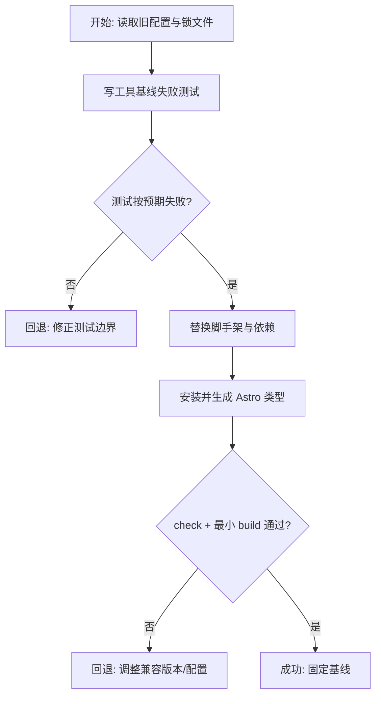
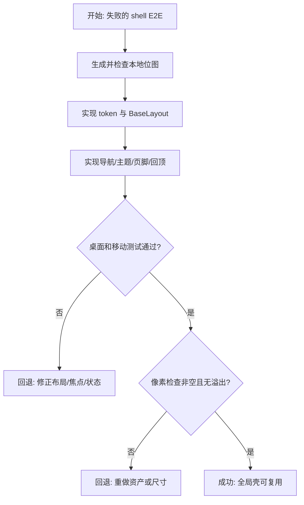
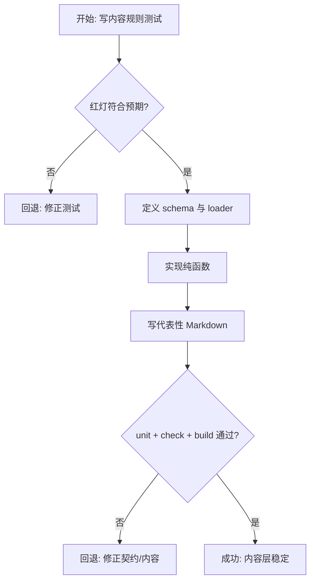
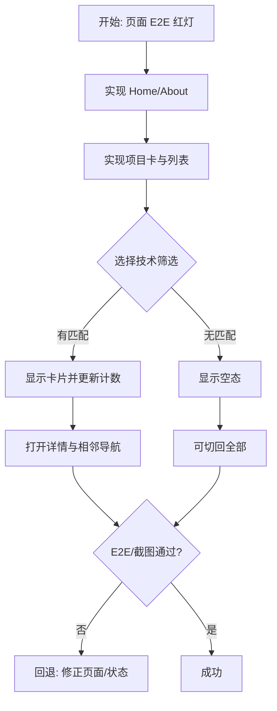
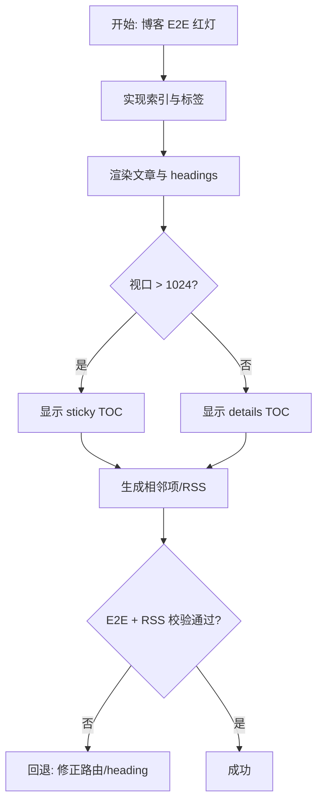
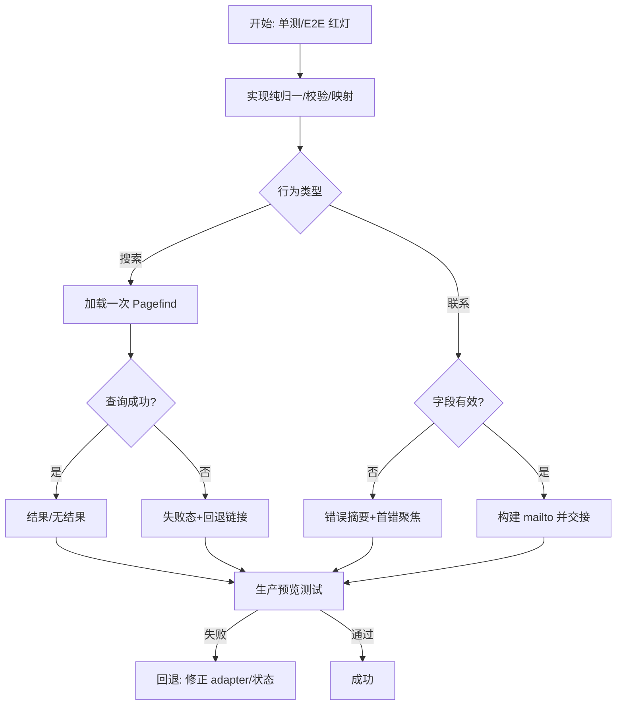
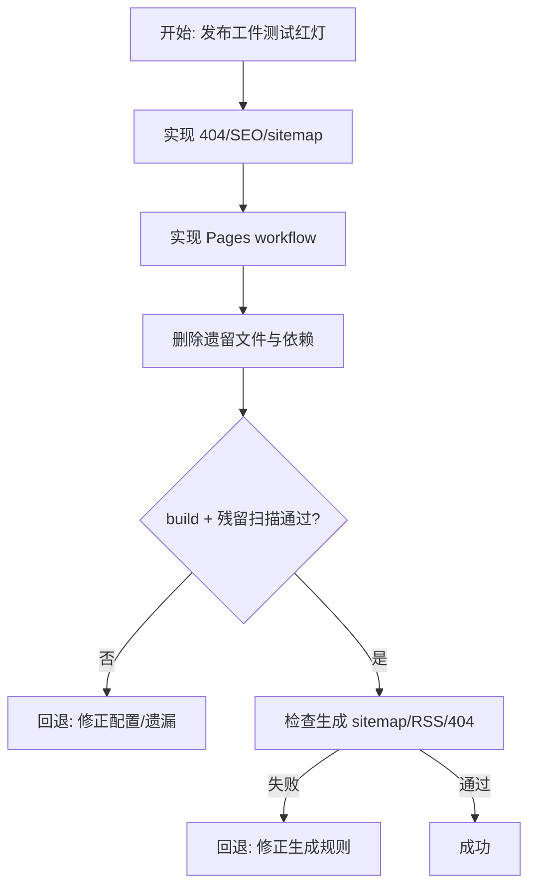
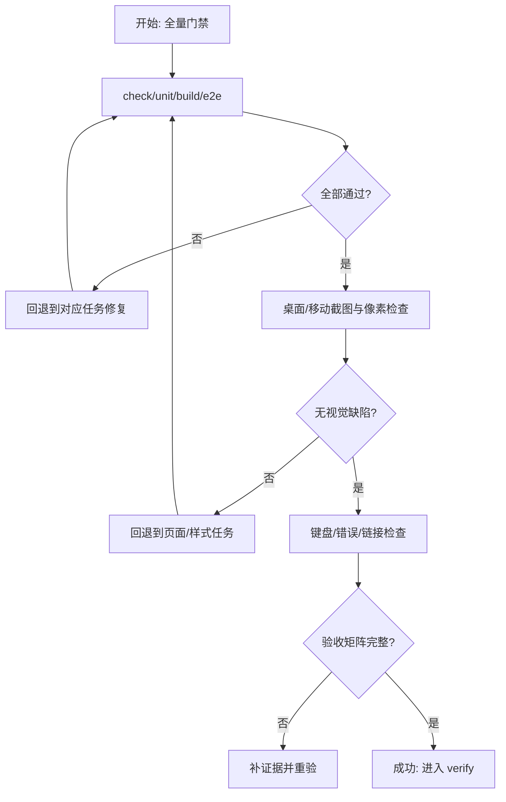
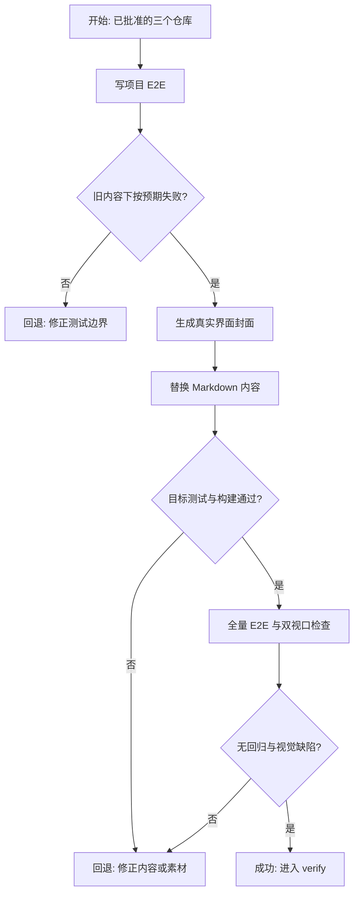

# 个人作品集 Astro 重构实施计划

> **For agentic workers:** REQUIRED SUB-SKILL: Use `superpowers:subagent-driven-development` (recommended) or `superpowers:executing-plans` to implement this plan task-by-task. Steps use checkbox syntax for tracking.

**Goal:** 将旧 Vue SPA 完整替换为符合已批准 spec 的 Astro 静态个人作品集，并通过构建、搜索、交互、响应式和部署验证。

**Architecture:** Astro 5 在构建期读取类型化 Markdown 内容并生成全部页面；原生渐进增强脚本只负责主题、菜单、筛选、搜索、联系表单和回顶。Tailwind 4 与全局 token 负责样式，Pagefind 在 Astro 构建后生成静态索引。

**Tech Stack:** Astro 5.18.x, TypeScript strict, Tailwind CSS 4, Astro Content Layer/MDX/Sitemap, Pagefind, `@lucide/astro`, Vitest, Playwright, pnpm.

**Spec:** `docs/requests/personal-portfolio-astro-rebuild/module-runs/portfolio-site/spec/spec.md`

## 全局约束

- Node 20 部署基线，Astro 固定 5.18.x；不得升级到要求 Node 22.22+ 的 Astro 7。
- 所有身份信息只使用仓库已确认事实，不虚构姓名、履历、头像、公司、教育、城市或社交账号。
- 无后端；联系表单只打开编码后的邮件草稿，不宣称发送成功。
- 内容可在无 JavaScript 时阅读；JS 只增强本地交互。
- 页面不使用装饰性渐变/光球，不嵌套卡片；图标统一使用 Lucide。
- 业务规则只保留一个所有者；不引入 Store、Event Bus、Manager、Factory 等无实际变化轴的抽象。
- 每个可测试行为遵守 red -> green -> refactor，并在任务板记录证据。

---

## 交付单元标识

`portfolio-site`

## 阅读导航

| 项目 | 内容 |
| --- | --- |
| 任务总数 | 8 |
| 串行任务 | 8 |
| 可并行任务 | 0（共享脚手架、内容契约和样式系统） |
| 高风险任务 | T06 Pagefind 搜索、T08 跨视口验收 |
| 主依赖链 | T01 -> T02 -> T03 -> T04 -> T05 -> T06 -> T07 -> T08 |
| 验收映射 | AC-01..13 均在任务中显式标注 |

## 全局摘要

实施从依赖/TypeScript/测试脚手架开始，随后建立视觉资产和共享壳，再建立内容契约与代表性内容。页面按共享依赖顺序完成，最后接入 Pagefind、静态邮件交接、GitHub Pages 和完整浏览器验证。最大风险是 Pagefind 只能在构建后验证，以及大范围替换时残留 Vue 配置；两者分别由预览 E2E 和遗留扫描兜底。

## 任务拆解

### T01：Astro 脚手架、类型与测试基线

**任务目标：** 在现有根目录应用官方 Astro minimal TypeScript 基线，替换旧包配置但不创建嵌套项目。

**规格映射：** Scaffold decision、Code context、AC-01、AC-11。

**文件：**

- 修改：`package.json`、`pnpm-lock.yaml`、`.gitignore`、`README.md`
- 创建/替换：`astro.config.mjs`、`tsconfig.json`、`src/env.d.ts`、`vitest.config.ts`、`playwright.config.ts`
- 删除：`vite.config.ts`、`babel.config.js`、旧 `tsconfig.*.json`、`auto-imports.d.ts`、`components.d.ts`、`index.html`、`e2e/vue.spec.ts`

**接口：** 产出命令 `dev`, `check`, `test`, `test:e2e`, `build:astro`, `build:index`, `build`, `preview`；后续任务只依赖这些命令。

**实现步骤：**

- [ ] 先写 `tests/tooling.test.ts`，读取 `package.json` 并断言存在 Astro 脚本、Node `>=20.3`、且无 Vue/Pinia/Element Plus 依赖。
- [ ] 执行 `pnpm vitest run tests/tooling.test.ts`，确认因旧配置失败。
- [ ] 将依赖锁定到 Astro 5 兼容组合；Tailwind 使用 `@tailwindcss/vite`，Pagefind 在 `astro build` 后运行。
- [ ] 替换 TypeScript 配置为 `extends: "astro/tsconfigs/strict"`，读取生成的 Astro 声明链并记录任何差异。
- [ ] 配置 Playwright 运行 `pnpm build && pnpm preview --host 127.0.0.1`，为生产索引测试预留。
- [ ] 安装依赖，运行工具测试、`pnpm check` 和最小构建。

**禁止猜测：** 不保留旧 Vite 插件；不直接采用 Astro 7；不将构建输出恢复为 `docs/`。

**风险与回退：** 若某集成最新版不支持 Astro 5，选择其明确声明兼容 Astro 5 的最近版本并记录；不得抬高 Node 基线。



### T02：视觉资产、设计 token 与全局页面壳

**任务目标：** 实现非空白、可响应、可访问的全局框架及本地视觉素材。

**规格映射：** Page/module design、Global shell、AC-02..05、AC-12。

**文件：**

- 创建：`public/images/identity.webp`、`public/images/projects/*.webp`、`public/images/og/default.webp`、`public/favicon.svg`、`public/robots.txt`
- 创建：`src/styles/global.css`、`src/site.config.ts`、`src/layouts/BaseLayout.astro`
- 创建：`src/components/Header.astro`、`Footer.astro`、`ThemeToggle.astro`、`ScrollToTop.astro`、`IconLink.astro`、`SectionHeading.astro`
- 创建测试：`e2e/shell.spec.ts`

**接口：** `BaseLayout` props `{ title, description, image?, type?, noindex? }`; `siteConfig` 提供 identity/navigation/contact/skills。

**实现步骤：**

- [ ] 先写 E2E：断言 skip link、导航、移动菜单、主题持久化、页脚、回顶和 console error 为零。
- [ ] 在空壳页面运行测试，确认失败原因分别对应缺失控件。
- [ ] 生成/保存 1 张抽象身份图、3 张项目封面和 1 张 OG 位图；检查文件可读、像素非空且主题一致。
- [ ] 建立 Tailwind 4 import、亮暗 token、排版、焦点、容器、prose、reduced-motion 规则。
- [ ] 实现 `BaseLayout` SEO/head 主题初始化和共享组件，确保菜单 Escape 后焦点回归。
- [ ] 在 390x844 与 1440x1000 运行壳测试和截图，修复溢出/遮挡。

**禁止猜测：** 不生成仿真人像；不添加不存在的 LinkedIn/城市；不用手绘 SVG 代替已有 Lucide 图标（favicon/品牌标记除外）。



### T03：内容集合、纯函数与代表性内容

**任务目标：** 建立唯一内容契约、排序/筛选/标签/阅读时间/相邻项规则及真实种子内容。

**规格映射：** API/Data contracts、Collections、AC-07、AC-12。

**文件：**

- 创建：`src/content.config.ts`、`src/lib/content.ts`、`src/lib/format.ts`
- 创建：`src/data/projects/*.md`（3 项）、`src/data/blog/*.md`（3 篇）
- 创建测试：`tests/content.test.ts`

**公开接口：**

```ts
getPublishedPosts(): Promise<CollectionEntry<'blog'>[]>
getPublishedProjects(): Promise<CollectionEntry<'projects'>[]>
getAllTags(posts): { label: string; slug: string; count: number }[]
getAdjacentEntries<T extends { id: string }>(entries: T[], id: string): { previous?: T; next?: T }
estimateReadingMinutes(body: string): number
formatDate(date: Date): string
```

**实现步骤：**

- [ ] 写失败单测：draft 排除、排序确定性、大小写标签合并/slug、边界相邻项、最少 1 分钟阅读时间和中文日期。
- [ ] 运行 `pnpm vitest run tests/content.test.ts`，确认函数不存在或行为失败。
- [ ] 定义 Astro `glob()` loaders 与 Zod schema，直接导出 collection 派生类型。
- [ ] 实现最小纯函数使单测通过，再重构重复规则。
- [ ] 编写三项旧工具概念项目案例和三篇中文技术文章；不得虚构客户/商业结果。
- [ ] 运行内容单测、`pnpm check`、构建，确认 frontmatter 全部通过 schema。

**数据约束：** 项目封面必须为 T02 本地路径；可选外链缺失时省略；文章至少一篇包含代码与多级标题供 TOC 验证。



### T04：首页、关于与项目体验

**任务目标：** 完成身份展示、技能、项目列表过滤和项目详情全链路。

**规格映射：** Home、About、Project list/detail、AC-02..07、AC-12。

**文件：**

- 创建：`src/components/ProjectCard.astro`、`ProjectFilter.astro`
- 创建：`src/layouts/ProjectLayout.astro`
- 创建：`src/pages/index.astro`、`about.astro`、`projects/index.astro`、`projects/[slug].astro`
- 创建测试：`e2e/projects.spec.ts`

**实现步骤：**

- [ ] 先写 E2E：Home 首屏身份/CTA/下一段提示、About 无虚构信息、项目筛选计数/空态、详情必需区块、上一项/下一项。
- [ ] 运行目标测试确认路由缺失而失败。
- [ ] 按 page-design 实现 Home/About，无简历时使用不可用说明而非死链接。
- [ ] 实现项目卡和渐进增强筛选；无 JS 时所有卡片可见，按钮用 `aria-pressed`。
- [ ] 实现详情静态路径、条件外链、正文/媒体/元数据栏和相邻导航。
- [ ] 运行项目 E2E、axe/键盘手工检查、移动/桌面截图；修复卡片高度和长标签溢出。

**交互状态：** 默认“全部”；筛选后更新计数；无匹配显示明确空态；筛选无需 loading 或二次确认。



### T05：博客、标签、文章目录与 RSS

**任务目标：** 完成技术内容发现、阅读、标签和订阅路径。

**规格映射：** Blog list/detail/tags、TOC、RSS、AC-02、AC-04、AC-07、AC-10。

**文件：**

- 创建：`src/components/BlogRow.astro`、`src/layouts/BlogLayout.astro`
- 创建：`src/pages/blog/index.astro`、`blog/[slug].astro`、`blog/tags/[tag].astro`、`rss.xml.ts`
- 创建测试：`e2e/blog.spec.ts`

**实现步骤：**

- [ ] 写失败 E2E：倒序文章、阅读时间、标签计数、代码块、多级 TOC、桌面/移动目录差异、相邻文章、RSS draft 排除。
- [ ] 运行目标测试确认路由缺失。
- [ ] 实现单列博客索引与标签导航。
- [ ] 使用 Astro render headings 构建详情布局；桌面 sticky TOC，移动 `details`。
- [ ] 生成标签静态路径与 RSS，并校验所有标签 URL 编码。
- [ ] 运行 E2E/check/build，键盘访问 TOC 并验证固定头部不遮住标题。



### T06：Pagefind 搜索与联系表单

**任务目标：** 实现生产索引搜索和严格输入语义的邮件交接。

**规格映射：** Search、Contact、Pagefind adapter、AC-04、AC-08、AC-09。

**文件：**

- 创建：`src/lib/contact.ts`、`src/lib/search.ts`
- 创建：`src/components/SearchExperience.astro`、`ContactForm.astro`
- 创建：`src/pages/search.astro`、`contact.astro`
- 创建测试：`tests/contact.test.ts`、`tests/search.test.ts`、`e2e/search-contact.spec.ts`

**公开接口：**

```ts
normalizeContact(values): NormalizedContact
validateContact(values): Record<'name' | 'email' | 'message', string | undefined>
buildMailto(values): string
normalizeQuery(query: string): string
mapPagefindResult(raw): SearchResult
```

**实现步骤：**

- [ ] 写失败单测覆盖姓名/邮箱/message trim、纯空格、Unicode 长度、CRLF、20/2000 边界、URI 编码、查询空白折叠和缺失 metadata fallback。
- [ ] 写失败 E2E 覆盖搜索 initial/loading/results/no-result、`q` 初始化、快速查询不串结果、联系 blur/submit 错误与首错 focus。
- [ ] 先实现纯函数通过单测，再实现组件 DOM 协调。
- [ ] Pagefind 只加载一次；以当前 query token 防止旧响应覆盖；异常转失败态并保留导航链接。
- [ ] 联系表单 valid 时设置 `window.location.href=mailto:`；测试拦截导航并断言编码内容，不显示“发送成功”。
- [ ] 运行 `pnpm build` 后在 preview 执行 E2E，确认博客和项目结果均可搜索。

**输入规则：** 完全照 spec；不得新增非法字符黑名单；长度按归一化后 Unicode 字符计算；无持久化、无 loading 提交态。



### T07：404、SEO、部署与遗留清理

**任务目标：** 完成静态发布表面并证明旧 Vue 运行时完全退出。

**规格映射：** 404/discovery、deployment、AC-10、AC-11。

**文件：**

- 创建：`src/pages/404.astro`、`.github/workflows/deploy.yml`
- 修改：`astro.config.mjs`、`README.md`
- 删除：所有残留 Vue/Vite/旧测试/无关公共媒体文件
- 创建测试：`tests/artifacts.test.ts`、`e2e/discovery.spec.ts`

**实现步骤：**

- [ ] 写失败测试：检查必需生成文件、canonical/sitemap/RSS、404 shell、deploy workflow Node 20/pnpm/build/dist、依赖与源码中无 Vue 运行时引用。
- [ ] 实现 404 与 canonical site/sitemap 配置。
- [ ] 编写 GitHub Pages Actions：checkout、pnpm setup、Node 20、frozen install、build、upload-pages-artifact、deploy-pages。
- [ ] 删除遗留根配置/测试/素材并更新 README 的内容编辑与部署说明。
- [ ] 运行 artifact/discovery 测试、完整 build；使用 `rg` 扫描 Vue/Pinia/Element Plus 残留。



### T08：全量验证、视觉检查与交付证据

**任务目标：** 按 AC-01..13 完成最终门禁并生成可复查证据。

**规格映射：** 所有 acceptance criteria。

**文件：**

- 修改：测试文件（仅修正验证覆盖，不新增产品行为）
- 生成：`module-runs/portfolio-site/execution/changelog.md`（执行阶段）
- 后续生成：verification/review 工件（由对应阶段负责）

**实现步骤：**

- [ ] 执行 `pnpm check`、`pnpm test`、`pnpm build`、`pnpm test:e2e` 并保存退出状态/关键摘要。
- [ ] 用 Playwright 截取 Home、Projects、Blog article、Search、Contact 的 1440x1000 与 390x844 图像。
- [ ] 检查截图和页面几何：无重叠、横向溢出、空白图片、文字裁剪；canvas/图像像素非空。
- [ ] 键盘走查导航、主题、筛选、TOC、搜索、表单；检查 console/page errors。
- [ ] 运行构建产物链接/路由抽查和 `git diff --check`。
- [ ] 任何失败立即回到对应任务修复并重跑最小测试，再重跑全量门禁。



## 功能拆解明细

| 功能单元 | 所属任务 | 完成定义 |
| --- | --- | --- |
| Astro/TS/命令/测试脚手架 | T01 | Node 20 兼容、strict check 和最小 build 通过 |
| 主题、菜单、SEO shell、footer、回顶 | T02 | 状态、键盘、移动/桌面可用 |
| 项目/文章 schema 与内容规则 | T03 | schema 校验、draft/排序/tag/adjacency 测试通过 |
| Home/About/Projects | T04 | 展示、筛选、详情和相邻导航通过 E2E |
| Blog/Tags/TOC/RSS | T05 | 文章阅读与发现路径通过 E2E |
| Search/Contact | T06 | 全部状态与输入边界通过 unit + preview E2E |
| 404/SEO/Pages/清理 | T07 | 生成工件完整且无旧运行时残留 |
| 跨视口最终验收 | T08 | AC-01..13 均有证据 |

联系表单字段顺序固定为 `name -> email -> message -> submit`；归一、长度、错误触发、焦点和副作用规则以 T06/spec 为唯一口径。项目/博客没有表格、分页或批量操作，不得在执行中增加。

## 项目脚手架与初始化策略

使用官方 Astro minimal TypeScript scaffold 的文件结构和 strict preset，在仓库根目录手动落地以保护已有 git/docs。裁剪欢迎页，增加 Content Layer、MDX、Sitemap、Tailwind 4 Vite plugin、Pagefind、Lucide、Vitest、Playwright。固定版本/Node 选择不得在执行中重决策。

## API 对接与类型策略

- 无服务端 API。
- Astro Markdown/Zod schema 是内容权威契约；类型直接使用 `CollectionEntry`。
- Pagefind 是唯一外部运行时契约，由 `mapPagefindResult` 适配为本地 SearchResult。
- `mailto:` 是单向 OS 交接，无 response/success contract。
- `tsconfig.json -> astro/tsconfigs/strict` 是新源码 governing chain；仅读取 Astro client/generated declarations 和直接依赖类型，不全仓扫描 `.d.ts`。

## 依赖关系

所有任务串行。T01 提供运行基础；T02 提供壳/token/资产；T03 提供内容；T04/T05 产出可索引页面；T06 依赖构建后的这些页面；T07 固化发布；T08 统一验收。

## 整洁性与复杂度控制

- 规则所有权：内容规则在 `lib/content.ts`，输入规则在 `lib/contact.ts`，搜索映射在 `lib/search.ts`。
- 页面只查询/组合；组件只渲染或协调一个局部交互。
- 所有 optional link 使用条件渲染，无 `href="#"`。
- 任何超过单一责任的文件先按现有边界拆分，不引入通用 service/manager。

## 模式决策与替代方案

仅 Pagefind 使用轻量 Adapter。Store、Observer/Event Bus、Strategy、Factory、Repository 均无真实变化轴，被明确拒绝。若实现发现第二个 provider，必须回退 spec/plan，而非现场加层。

## 代码上下文与影响范围

整个旧运行时配置、源代码、测试、公共素材均在影响面内；PRD 和请求工件保留。现有用户删除不回滚。`docs/requests/**` 必须继续可追踪，`dist/` 保持忽略。

## 并行执行建议

不启用 workflow 并行。页面、样式、内容和搜索索引高度耦合，任务总量适合单一执行上下文；并行收益小于合并与视觉漂移风险。

## 触发与上下文准备

触发条件是 plan 审批。执行前重读当前 `state.json`、spec、plan、TypeScript/code-context；每项任务完成后更新 task board/changelog。用户可通过任务板观察与中止；任何产品含义变化回退 spec。

## 受影响文件或模块

根配置、`src/**`、`public/**`、`tests/**`、`e2e/**`、`.github/workflows/deploy.yml`、README、lockfile。请求工件只按生命周期追加/更新。

## 测试策略

- Vitest：工具契约、内容纯函数、联系归一/校验/mailto、搜索 query/result adapter、构建工件检查。
- Astro check：schema、页面 props、Content Layer 与 Astro 模板类型。
- Playwright production preview：全部关键页面、theme/menu/filter/TOC/search/contact/404、桌面/移动。
- 视觉验证：固定视口截图、几何溢出检测、图片自然尺寸/像素非空。
- 手工证据：键盘顺序、可见焦点、reduced motion、生成 sitemap/RSS/Pagefind 文件。

## 观察与人工介入点

- 依赖不兼容 Node 20：记录证据并停在 T01，不擅自升级运行时。
- 需要真实履历/照片/简历才能继续：使用批准 fallback，不阻塞；不得虚构。
- Pagefind 生产预览失败：停在 T06 修复，不降级为假搜索。
- 最终交接：本地 URL、变更摘要、测试证据、可替换内容位置和外部 Pages 设置步骤。

## 回滚说明

每个任务通过测试后才进入下一个。失败优先在当前任务恢复到最近通过状态，不恢复已批准删除的 Vue 文件。若架构假设失效，按框架回退 architecture-design；若产品行为需变更，回退 spec/plan。

## T09：真实 GitHub 项目内容更新

**任务目标：** 用已批准的三个真实公开仓库替换概念项目，保留现有内容架构、筛选、详情与首页精选行为。

**规格映射：** Approved Content Update、AC-06/07/12/14/15/16。

**范围与影响面：** `e2e/projects.spec.ts`、`src/data/projects/*.md`、`public/images/project-*.webp`；页面组件、schema 与排序函数不改。

**实现子项：**

- 先更新项目 E2E，断言三个标题、Rust 筛选、BiliCatch 详情、GitHub/演示外链与相邻导航，并确认旧内容下按预期失败。
- 从 BiliCatch 已提交验收截图、SkillHub GitHub Pages 和可视化项目 Vercel 页面生成 1200x750 WebP 封面。
- 删除三个概念 Markdown 和对应概念封面，新增三个真实项目案例；只写已核实技术与行为，不写虚构量化结果。
- 运行目标 E2E、内容/类型检查、构建、完整 E2E，并检查桌面/移动 Projects 截图和图片像素。

**数据/API 与类型约束：** 无运行时 API；GitHub 公共仓库是事实来源，继续使用现有 Astro `projects` collection contract 与 `CollectionEntry` 类型。

**整洁性与模式约束：** 内容变更不新增组件、adapter 或状态层；项目事实只存在于 Markdown，页面继续通过统一 collection helpers 查询。

**风险与回退：** 外部演示不可访问时保留 GitHub 链接并记录，不伪造 demo；截图失败时回到已核实的仓库截图源，不恢复抽象占位图。


